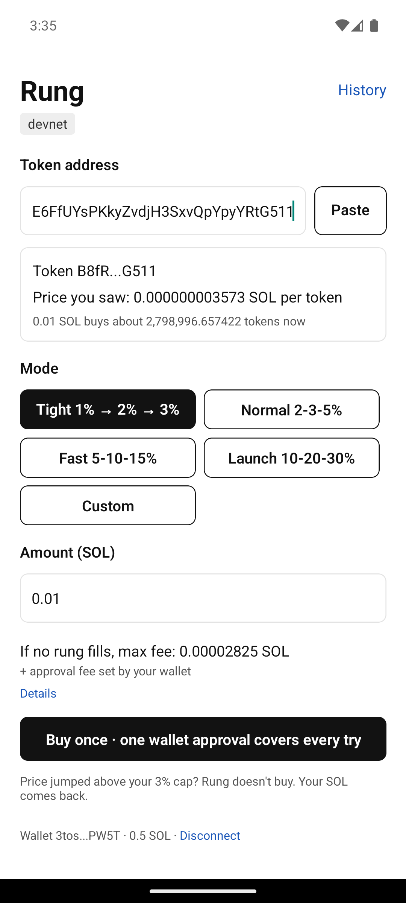
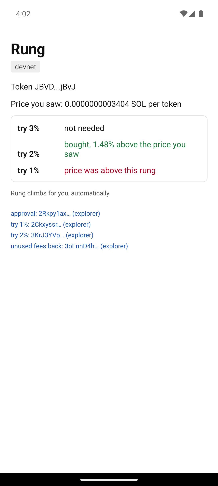
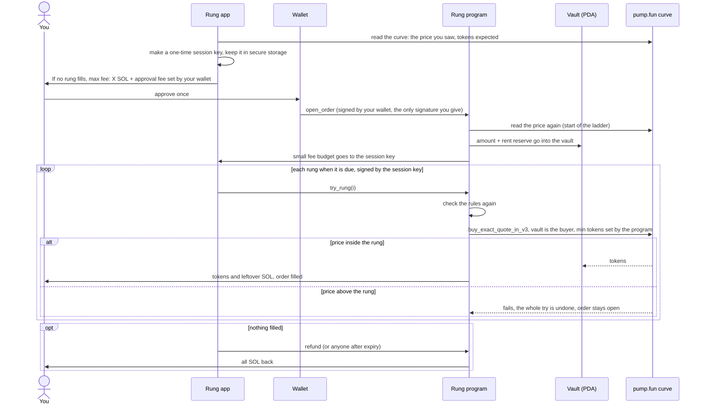

# Rung — stop guessing slippage. Stop feeding sandwich bots.

On Solana, set slippage too wide and a sandwich bot takes the gap; set it too tight and your buy fails. Rung finds the lowest slippage that fills: it tries 1% first, climbs only to your cap, and buys once. One approval.

- 2 out of 3 manual buys set more than 5× the slippage they needed (median typed 20%, needed 1.1%).
- 1 in 4 manual buys had no slippage protection at all.
- On established tokens, 97% of buys fill on the first 1% try.

**Live web page:** https://rung-drab.vercel.app/ (its counter reads devnet)<br>
**Program address (devnet):** [`Ej2bWTwgPULuni3RVS7Krg1cNYrm5Em5WqfMcUVJUhio`](https://explorer.solana.com/address/Ej2bWTwgPULuni3RVS7Krg1cNYrm5Em5WqfMcUVJUhio?cluster=devnet) · **mainnet:** [same address](https://explorer.solana.com/address/Ej2bWTwgPULuni3RVS7Krg1cNYrm5Em5WqfMcUVJUhio), deployed Nov 24, 2026; first buys the same day<br>
**Demo video:** not yet

<p>
  
  
</p>

*Left: the buy screen. Right: a ladder that climbed — the 1% try missed, the 2% try bought 1.48% above the price you saw, the 3% try was not needed. Both are screenshots of real transactions on **devnet** (test SOL) from the Android emulator. In the right-hand run the price was pushed up on purpose by a buy from our own second wallet, as a test aid, so that the first rung would miss.*

---

*Slippage* is the most you accept paying above the price you saw; if the price moves past it, the buy fails and only the fee is spent.

A *sandwich bot* buys right before you, pushes the price up to your slippage limit, and sells right after you: it can take at most your slippage.

(1) *No guessing.* Even if you don't know what to type, you buy at the right slippage: Rung starts tightest and climbs only as needed. (2) *Sandwich protection.* An attacker can take at most your cap, and on Rung the first try starts at 1%; even for brand-new tokens, Launch mode starts at 10%, not 20–30%. (3) *You don't overpay.* If the price jumped above your cap, Rung doesn't buy; if it buys, you pay at most your cap above the price you saw. (4) *One approval, one buy.* Every try is covered by one wallet approval; the program allows at most one buy; if nothing fills, your SOL comes back.

| mode | rungs | for | fills (3 windows) |
|---|---|---|---|
| Tight | 1% → 2% → 3% | established tokens | 98.7–99.4% |
| Normal | 2% → 3% → 5% | established tokens, everyday buys | 99.3–99.7% |
| Fast | 5% → 10% → 15% | most-traded, fast-moving pools | 99.2–100% |
| Launch | 10% → 20% → 30% | a token's first two minutes | 93.6–95.2% |
| Custom | you choose 1–5 rungs and the cap | | |

At launch, Tight fills 80–81% of buys; the rest are buys where the price ran above 3%. Rung shows them as *not bought, your SOL is back*. If you must get in at launch, pick Launch.

- On a typical buy the price doesn't change; Rung makes the difference during attacks and spikes.
- Sandwich numbers are Bitquery's; our measurement shows the gap between the slippage typed and the slippage needed.
- Measured on three 13-minute windows from the week of Nov 19–22, 2026, 232,770 buys; 'manual buy' is a behaviour rule (at most three transactions in the window, one per block, no custom program).

---

## How to try

The app and the web page run on **devnet** (test SOL). The program is deployed on mainnet as well (Nov 24, 2026), and the command-line script has bought there: see [Mainnet runs](#mainnet-runs).

| way | state |
|---|---|
| Install the APK | not yet: no APK is published |
| Build the Android app from source and run it on an emulator | works on an Android 15 emulator with Phantom, Solflare or Solana Mobile's mock wallet, set to devnet. Steps in [`app/README.md`](app/README.md) |
| Run the ladder from the command line | works: [`scripts/ladder.ts`](scripts/ladder.ts) opens an order and tries the rungs on devnet, see below |
| No Android at hand | the [web page](https://rung-drab.vercel.app/) shows the counter of the program's devnet transactions, and the explorer links below show real devnet runs |

### Command line (devnet unless told otherwise)

```bash
cd client && npm install && cd ..
client/node_modules/.bin/tsx scripts/ladder.ts --find-mint
client/node_modules/.bin/tsx scripts/ladder.ts --mint <MINT> --amount 0.01 --mode tight --dry-run
```

Drop `--dry-run` to send real devnet transactions. The script signs with a devnet keypair file (default `~/.config/solana/rung-devnet.json`, or `--keypair <file>`) that you fund with devnet SOL yourself.

The script refuses a mainnet RPC unless `--mainnet` is given, and refuses `--mainnet` on anything that is not mainnet. With `--mainnet` the SOL is real, so the rules are tighter: `--keypair` has no default, an order is at most 0.01 SOL, the test aids that move the price are refused, and without `--yes-real-sol` the script prints the plan and sends nothing. The rules are in [`scripts/network.ts`](scripts/network.ts) with their tests in [`client/test/network.test.ts`](client/test/network.test.ts). The first mainnet runs are below.

Rung only buys. To take a test buy back, `--sell-all --mint <MINT>` sells the wallet's whole balance of the token where it trades (its curve or its PumpSwap pool) from the plain wallet and closes the emptied token account.

### Mainnet runs

The first buy on mainnet, Nov 24, 2026, sent with the same script (`scripts/mainnet.sh`): Tight mode (1% → 2% → 3%), 0.01 SOL, mint `Ai66LHZG9MCzg1WKdawwqduVAXpNDUuV8M3uyq5ppump` on its own PumpSwap pool (about 8,988 SOL in the pool). The wallet signed one transaction, the order; the try and the sweep were signed by the one-time session key.

| step | what happened | fee |
|---|---|---|
| [order](https://explorer.solana.com/tx/4J9FJo5UPbdD8t1UQ4E9gouEDDmXmzfPiseawLXPKv1GjG5k48mypXTXyAG2rTX1fYhyPpP5ziwEUYx4Fy6sYEzu) | `open_order` in slot 473337656; quote 41.147423 tokens | 0.000005 SOL |
| [rung 1%](https://explorer.solana.com/tx/2ZNEtvVpsiTVdcpgxoiBXBnTeknSoo1VhMwCmjhw4vHd4w7cCfP75BuQw74yf2buTXfhBKcXY7qQwYJyWj4kNt5U) | filled six slots later: 41.147423 tokens for 0.01 SOL, the quoted amount exactly (paid +0.00% vs. seen); 195,038 compute units | 0.0000063 SOL |
| [sweep](https://explorer.solana.com/tx/4mvpngmiHyqJDCUykdTzGh3GydBAU7VTzeLWzknZFd7PgGwqPoahTeY67fdowz8cjHrbTk5r6YNmzyYmLc4SAEa) | what was left on the session key went back to the wallet | 0.000005 SOL |

Rung's fees for this buy: 0.0000163 SOL. The tokens were then [sold back](https://explorer.solana.com/tx/97KiD1BwqNmtP2MTjhT2ctA7aNpg5sm7Zzt8UKui6mDhiqKgKTVSoD4DsZ5LpfmRQgikpaLkevRdeEHAd7uCYLh) from the same wallet with a plain PumpSwap sell (`--sell-all`), and the order account was [closed](https://explorer.solana.com/tx/5RyYStquEhKbqYZDzCcWz6EmyEnXbNvk4cyn3oXoisaJZVfY5gzuS5faR3bjsPrLcYSXMYwptnK2BBoGf5hKsnyN) after the order's lifetime. Over the whole round trip the wallet ended 0.001432328 SOL lower: 0.0013462 SOL is the rent of the volume account PumpSwap opens once for the wallet's vault, and the rest is PumpSwap's 0.30% fee on the buy and on the sell plus five transaction fees.

The second buy, the same day, from a pump.fun bonding curve: Tight mode, 0.01 SOL, mint `3DkJhLpCpbWjs96zaBhFc2Y7fdFXnj2NffWcweeFpump` (market cap about 60 SOL at the time).

| step | what happened | fee |
|---|---|---|
| [order](https://explorer.solana.com/tx/JZrcxkfTTmVCGxhngcwaQXyVnbHvHiHniYWshhuXvvEhNwU3q3GFv5zCXcgu4ESQ2PLyMJAEY8K23bj94TLxhCX) | `open_order` in slot 473343599; quote 165,832.428299 tokens. By the time the order landed the price had risen 0.64%, and the program started the ladder from the price it read | 0.000005 SOL |
| [rung 1%](https://explorer.solana.com/tx/GY6Y2LdzeJj1Zch3XFuTuXvvPVKroEGFAR2ZFqjEcsaCpCRuqHs8JAMuE1Fr2Tigrk1PQht6DH6L4KVgRRWwzQM) | filled nine slots later: 164,333.093723 tokens for 0.01 SOL, 0.91% above the price seen and 0.27% above the price the program read; 139,666 compute units | 0.000006 SOL |
| [sweep](https://explorer.solana.com/tx/N8UyWcXN3LhSRgQhTKLQXNZTrBvP8ZHUZFpUHvYmcSqmE9rp1rhXikzR6KddpRoiGz8sBPUPJg7rVEpPyBwrgw2) | what was left on the session key went back to the wallet | 0.000005 SOL |

Rung's fees for this buy: 0.000016 SOL. The tokens were [sold back](https://explorer.solana.com/tx/4vnepcwMAwWsC52vAgAJk4JXAY42kpU25dSbHu5ErqK6EciQAVWP5r1YftE9roUB4hSDxrzkxeLZFpru5JFvF6g5) with `--sell-all` and the order account was [closed](https://explorer.solana.com/tx/TtBDALpbKUsF9EekG3wSGWLyooVrB1KL2tmqiJVJXQAtPSGHSvdHSCkyhBEXKtUc4JvAXYoT6gwNuTi2h8oP5Ku).

A run that did not buy, the same day: Tight mode, 0.01 SOL, on a curve in its launch rush (mint `5Z7jsmLUBwJM9g8sKg9FfwNdRuR2bnTCcWSraWTKpump`, about 200 trades a minute; the script picked it with `--mint busy`). By the time the [order](https://explorer.solana.com/tx/4A7ztAKgT1y32ajVq3fciAdzTXE9hokaRNTPKaiw1SUXfCChFtyo9nfqLRNwc6LGDy9zN5gV2uGP7pK2HYmCWoAD) landed the price was already 8.4% above the price seen, past the 3% cap. The rungs [1%](https://explorer.solana.com/tx/3wB8z2aNWztZGCBeKb69nVrhzbsvYacFjKujyWYYm2YgwxYakNTSR3DmqFY3NuyCWvw4B8XG9MHys5TuFEGkaUpe), [2%](https://explorer.solana.com/tx/3HE377FqavBvnJgYmTqavo9UTvLQJS1B9oM2dWwBaFHNuGA4xtMDqTfNr5hRzzR2r5JG4eubgMHzpsf8desVfdbG) and [3%](https://explorer.solana.com/tx/3c8tjAv76CGZKcYRBPAX8cjWtWsoscMmYCY8WgDc6pAELBeU4tXPtxg2gogwBthRjpGAovKhp43a1Erx7hhW3cEG) each failed with pump's error 6042, the [refund](https://explorer.solana.com/tx/4wQ8yDtGHnN79RfW1RopfpvPqqQxG3gnPrG33HzjgKBg7Lzcqt2bAmpAfH1TbSPHsj4Fwi5i8Y4TGsKnaaLeFprn) returned the order amount and the rent reserve in full, and the [sweep](https://explorer.solana.com/tx/2QqD5MyWp9zPDa9CchNuAQZiXQdQwgdCpCbAh6gQhJvDiqQn9KJV8rnvaePdh184Q9L2k7wxF3ef135dHL5tvknM) emptied the session key. The wallet ended 0.00003325 SOL lower: the "max fee" the plan had printed before the order, to the lamport.

### Devnet runs

Real transactions on devnet (test SOL, pump's devnet deployment, a live devnet curve), sent with the script (`scripts/ladder.ts`, then named `devnet-ladder.ts`) on Nov 23, 2026. Tight mode (1% → 2% → 3%), 0.01 SOL, mint `B8fRBPHkEVfqE6FfUYsPKkyZvdjH3SxvQpYpyYRtG511`. The wallet signs one transaction (`open_order`); every try is signed by the one-time session key.

In the second and third run the price was moved on purpose by a buy from our own wallet right after the order opened. That push is a test aid of the script, not part of the product.

| run | what happened | paid vs. seen | fees |
|---|---|---|---|
| price did not move | [rung 1% filled](https://explorer.solana.com/tx/5rG3LwqhXeFhrws96mwfUV57uoJy3SypETcBcymZoMotRhiPgswsowYL6JSrajkezuxMBVRXGwhybE2xn8ghJjnm?cluster=devnet) | +0.00% | 0.000016 SOL |
| price pushed +1.5% | [rung 1% failed](https://explorer.solana.com/tx/3qyr6rUPTvSjsKZfmU2j8v4QZsecooCRWytbTpvzML6Tm67zrfSpLf9mDKtThGxsWTSgchcGmtNbBz2wQYTT6qiF?cluster=devnet) with pump's error 6042, [rung 2% filled](https://explorer.solana.com/tx/3gZ8WhEJkWruaDSDrzyA3xT7xMBHo2gro89aStjz6FqxE3Ski6fwwnWGHh1jZPcVQCALJzK14q1fofr7P6uX3ftr?cluster=devnet) four slots later | +1.49% | 0.000022 SOL |
| price pushed +4.5%, above the 3% cap | rungs [1%](https://explorer.solana.com/tx/35SeeE5X7q9J3QFkLquzBiWCZR3BbpX7ypYurbv6sJiJRZj8yRxGgHCpA9yYTNKkV9jJioQ7yYdDDF9YRc2z7wGg?cluster=devnet), [2%](https://explorer.solana.com/tx/26P3nKWRRRHNVL5A2rwtPDC6i5wMnhbZXg6BL15GMdEB5D14hLv5mtf4SWcW5Kq2xSyfBaoc2Rkbv1iaJG29o6Wy?cluster=devnet) and [3%](https://explorer.solana.com/tx/3FbWyrKHhjQJsdGeF5RthSBYTTYd8c45mwPbxpDicFiaLiX5eg6TytVweCd7HuWPq9ccymeu8hHZE9Trxg2QwH1C?cluster=devnet) all failed, then the [refund](https://explorer.solana.com/tx/2Q2XYpHszQS6P62587rnmjNdmSzJKAWcZDdv2Pgg8o1FFhWfrTFDncor7R4LkN8EoVtZnJhMKfGZ4HupZ9Vy75xQ?cluster=devnet): not bought, the order amount and the rent reserve came back in full | not bought | 0.00003325 SOL |

A buy from a PumpSwap pool, same script, Nov 24, 2026 (mint `CSyeF5X2hcMVMDiGPRmEuc6p7gXQRHgjUNT8mi1hHvae`, its canonical pool, Tight, 0.01 SOL): [order](https://explorer.solana.com/tx/54UvizzNC9zM4utpgBgvvWGdHhhHYKJCcC188sGK1fjFUVHN5j7yvLJhpe6tLzSuG4YXQ4fNJtnYFtUv2o3qnTh9?cluster=devnet), [rung 1% filled](https://explorer.solana.com/tx/23mmMaD4b5HK5S4jsvG6fS55rpUNS14ePWu4psP8fWuCEagh1u4qLKLdhx8FaEsQQetDkNCrYGGhaegwh4UY8Tk2?cluster=devnet) six slots later, paid 0.04% above the price seen. A pool try that buys used 154,000 to 171,000 compute units in three such runs; pool tries are sent with a limit of 260,000, so each costs 6,300 lamports at the same price.

Measured on devnet in these runs: a `try_rung` that buys used about 123,000 compute units, one that fails on slippage about 94,000, the refund about 9,000. With a compute-unit limit of 200,000 and a price of 5,000 micro-lamports each try cost 6,000 lamports whether it bought or not.

The app's own devnet buys (Phantom, Solflare, a not-bought run and its "Retry with Launch mode") are listed with their signatures in [`app/README.md`](app/README.md#known-issues--wallet-notes). Screenshots: [buy](docs/shots/app-1-buy.png), [wallet approval](docs/shots/app-2-approval.png), [ladder](docs/shots/app-3-ladder.png), [receipt](docs/shots/app-4-receipt.png), [not bought](docs/shots/app-5-not-bought.png), [retry](docs/shots/app-6-retry.png), [climb](docs/shots/app-7-climb.png), [history offline](docs/shots/app-8-history-offline.png).

## Status

| part | state |
|---|---|
| On-chain order program (Anchor) | deployed on **devnet** at [`Ej2bWTwgPULuni3RVS7Krg1cNYrm5Em5WqfMcUVJUhio`](https://explorer.solana.com/address/Ej2bWTwgPULuni3RVS7Krg1cNYrm5Em5WqfMcUVJUhio?cluster=devnet). Buys on pump.fun bonding curves and on PumpSwap pools. Reviewed twice by independent read-only passes, not audited |
| Mainnet | the program is deployed at [`Ej2bWTwgPULuni3RVS7Krg1cNYrm5Em5WqfMcUVJUhio`](https://explorer.solana.com/address/Ej2bWTwgPULuni3RVS7Krg1cNYrm5Em5WqfMcUVJUhio) since Nov 24, 2026 (same address and same build as on devnet). Two buys the same day, through the script: from a PumpSwap pool ([rung 1% filled](https://explorer.solana.com/tx/2ZNEtvVpsiTVdcpgxoiBXBnTeknSoo1VhMwCmjhw4vHd4w7cCfP75BuQw74yf2buTXfhBKcXY7qQwYJyWj4kNt5U)) and from a bonding curve ([rung 1% filled](https://explorer.solana.com/tx/GY6Y2LdzeJj1Zch3XFuTuXvvPVKroEGFAR2ZFqjEcsaCpCRuqHs8JAMuE1Fr2Tigrk1PQht6DH6L4KVgRRWwzQM)). The app and the web page still use devnet |
| PumpSwap pools | in the program, the client, the command-line script and the Android app. Tested locally against a test double and the real PumpSwap program dumped from mainnet, on a local fork of mainnet, and with real buys on a devnet pool through the script and through the app (runs in [`app/README.md`](app/README.md#pumpswap-pools)), and with a real buy on a mainnet pool through the script ([Mainnet runs](#mainnet-runs)) |
| Android app (`app/`) | works on **devnet** on an Android 15 emulator: paste a token, pick a mode, one wallet approval, live ladder, receipt, not-bought screen with retry, history that opens offline. Buys filled with Phantom, Solflare and Solana Mobile's mock wallet. Not tested: Custom mode, a real device, Seeker, mainnet |
| APK | not yet |
| Web page (`web/`) | live at https://rung-drab.vercel.app/; the counter is computed from the program's devnet events |
| Measurement scripts (`measure/`) | in the repository; verified on a small slice, not re-run end to end |
| Demo video | not yet |
| Team's own mainnet buys | not yet |

## Problem

Every manual buy on a memecoin asks for one number, the slippage, and both ways of getting it wrong cost money.

**Too wide.** A sandwich bot can push the price up to your limit and take the gap. Bitquery counted 6,850,144 sandwiches on Solana between Oct 30, 2025 and Oct 7, 2026, $29.7M gross, 96% of them on pump.fun curves and PumpSwap. In its sample of 10,000 Jupiter swaps, buys at 1–3% slippage had 8 victims, buys at 20–50% had 148. Yet in our measurement, manual-like buys of $5–500 typed a median of 20.0% when they needed 1.10%, and 26.8% of manual-like buys had no protection at all. The settings screens of Axiom and Photon come set to 20% for buys (our own reading).

**Too tight.** The price moves past your limit, the buy fails and you still pay the fee: a median of $0.00041 for a failed slippage try across all buys, $0.016 for manual-like buys. Then you guess again.

You have to pick that number before the buy. Rung does not ask for it: it starts at the tightest rung and climbs only as far as you allow.

## How it works



1. **Quote.** The app reads the pump.fun bonding curve and shows the price you saw and how many tokens your amount buys now.
2. **One approval.** The app makes a one-time session key for this buy and keeps it in the phone's secure storage (`expo-secure-store`). Your wallet then signs one transaction, `open_order`. It writes the order on chain (rungs, cap, amount, the tokens you expect at the price you saw, timing, the session key), moves the amount and a small rent reserve into a vault the program controls (a program-derived address per user; one open order per user), and sends the session key a small fee budget for the tries.
3. **The rungs.** The session key sends one `try_rung` per rung as it becomes due (4 slots apart in the devnet runs). The program buys through pump.fun's `buy_exact_quote_in_v3` with the vault as the buyer. If the price is above the rung, pump fails the transaction, nothing moves, the order stays open and only that try's fee is spent.
4. **Filled or refunded.** On a fill the tokens go to your token account and the SOL that was not spent goes back to your wallet, in the same transaction; the order is marked filled and every later try is rejected (`OrderFilled`). If no rung fills, the session key calls `refund` (anyone may call it once the order has expired) and the vault's SOL and the order account's rent go back to you. You can also `cancel` with your own wallet, which is a second approval. Afterwards the app sends what is left of the fee budget back to your wallet and deletes the session key.

### How does one approval cover every try?

Your wallet signs only the transaction that writes the order and its rules on chain. The tries are sent by the one-time session key tied to that order, and the program checks the rules again on every try:

- the signer is the session key written in the order;
- the order is still open and has not bought yet (at most one buy per order);
- the rung exists in the order, so it is not above the cap;
- the rung is due (`start slot + rung × window`) and the order has not expired;
- the fewest tokens the buy may return is computed by the program from the order, not by the key.

The session key cannot loosen any of these, cannot send SOL anywhere but to you, and holds only the fee budget.

**Two references.** The fewest tokens a rung may buy is the stricter of two limits: (1) the cap measured from the price you saw when you tapped Buy, so no buy is ever more than your cap above that price; (2) the rung measured from the price the program read from the curve when the order landed on chain, which is where the ladder starts.

**The program measures the buy itself.** After pump returns, the program checks the increase in the vault's token account against the rung's minimum, and checks that the SOL that left the vault is at most the order amount plus a small rent allowance (0.0025 SOL). It does not take pump's word for either.

### Fees

Before you approve, the app shows **"If no rung fills, max fee: X SOL"** and **"+ approval fee set by your wallet"**.

```
X = rungs × (base fee + compute-unit limit × compute-unit price ÷ 1,000,000)     (lamports; price in micro-lamports per unit)
```

With the values of the devnet runs (limit 200,000 units, price 5,000 micro-lamports, base fee 5,000 lamports) each try costs 6,000 lamports, so three rungs cost at most 18,000 lamports. The app also budgets the session key's own `refund` transaction (5,250 lamports) and the transfer that returns its unused fees (5,000 lamports), which is why the buy screen above shows 0.00002825 SOL for Tight mode. These compute values are temporary; they will be chosen from a measurement on mainnet, which has not been done yet. The program caps the fee budget an order can hand to the session key at 0.002 SOL.

The approval itself is a separate fee: the wallet, not Rung, sets the compute budget of the `open_order` transaction.

### Wallets

The wallet signs one transaction per buy, the order. Every try after that is signed by the one-time session key. Observed on an Android 15 emulator on devnet, Nov 23, 2026:

| wallet | sheets per buy | what the wallet added to the order | order fee |
|---|---|---|---|
| Solflare | one (after the first connect) | `SetComputeUnitLimit(200000)`, `SetComputeUnitPrice(100000)` | 25,000 lamports |
| Phantom | two: its Connect sheet, then Confirm | `SetComputeUnitPrice(375000)`, `SetComputeUnitLimit(200000)` | 80,000 lamports |
| Solana Mobile mock wallet | one | nothing | 5,000 lamports |

Neither wallet added any other instruction, and the added ones did not break the order. The fee of the order transaction is set by the wallet, which is why the app shows it as a separate line; the fees of the tries are set by the app.

Phantom asks to connect again before every buy because it declines the saved authorization of an app whose identity it has not verified. The app asks the wallet to sign and sends the signed order itself: with the wallet sending, Phantom's transaction never reached devnet and Solflare kept the app in the background while the order's time ran out. An approval that takes longer than about a minute fails with "Approval took too long" and nothing is sent.

## Numbers

### A. Our own measurement (scripts in this repository)

| number | sample | caveat |
|---|---|---|
| Manual-like buys of $5–500: median typed slippage 20.0%, needed 1.10%; 67.7% typed more than 5× | 4,955 successful buys, three windows | Quote assumed 3 slots before the buy; successful buys only; WSOL-based pools excluded |
| 26.8% of manual-like buys had no protection | 2,862 buys with stable price | Only buys whose instruction could be decoded and whose price stayed stable |
| On established tokens a single 1% try fills 97.4% | 52,373 buys, 1,211 pools (manual-like $5–500: 95.1%, 5,399) | Simulation; most buys are bots |
| Mode fill ranges (mode table) | three windows; launch 27,403, established 52,373, most-traded 47,448, transition 6,306 buys | Simulation (landing delay 3 slots; 2 and 4 slots as sensitivity); priority-fee race not modelled; 4–5 transition pools per window |
| 14.9% of buys with ≥20% slippage filled more than 5% above the seen price (average 30.5%); on a typical buy the difference ≈ 0 | 27,878 wide, 20,891 tight buys | Truncation effect; result depends on conditioning |
| Buys that appear to come through a trading app: 19.0% at exactly 20%, 30.1% unprotected | 9,602 buys with stable price | App names not verified on-chain; the signal is structural |
| Failed slippage try: median $0.00041 across all; manual-like median $0.016, p90 $0.56; priority fee is charged, Jito tip is not | 135,217 failed (manual-like 362); 35 transactions as direct evidence | Manual-like group small; depends on fee settings. The priority-fee / Jito-tip evidence (35 transactions) is in the method notes, not in the result tables |
| Team's own buys during event week: not yet (mainnet) | mainnet, event week | Small sample; tokens chosen by the team (to be filled from real data) |

*Devnet test buys, not part of this table:* the [web page](https://rung-drab.vercel.app/) counts the program's devnet transactions. It is a small sample of the team's own test buys and includes runs where we pushed the price on purpose.

The numbers about typed and needed slippage come from our own measurement of three 13-minute windows of mainnet blocks. The scripts are in [`measure/`](measure/README.md), with the tables they produced on Nov 22, 2026 in [`measure/results/`](measure/results/), and the method (in Turkish) in [`measure/docs/rapor-ikinci-olcum.md`](measure/docs/rapor-ikinci-olcum.md). [`measure/README.md`](measure/README.md#numbers--script) maps every row above to the script and output that produced it. They use public RPC endpoints only; the raw blocks are not in the repository and are downloaded again by the scripts (about 20 to 25 minutes per window). After being cleaned up for this repository the scripts were verified on a small slice against the original ones, not re-run end to end.

### B. Other people's measurements

| number | source | caveat |
|---|---|---|
| 6,850,144 sandwiches, 2,154,994 wallets, $29.7M gross; 96% on pump.fun curves and PumpSwap (Oct 30, 2025 – Oct 7, 2026) | Bitquery, Oct 12, 2026 | Single source; gross; address ≠ person |
| Daily sandwiches ≈ 3,400 → ≈ 51,900 | Bitquery | Not normalised by volume |
| Victims in 10,000 Jupiter swaps: 8 at 1–3% slippage, 44 at 3–10%, 148 at 20–50% | Bitquery | Jupiter swaps only; not reproduced in our sample |
| Sandwiches over three years: Solana 28.0M, Ethereum 30,607, Base 1,889 | arXiv 2609.28115 (preprint) | Not peer-reviewed; same method as Bitquery |

### C. Settings screens

<!-- TRANSLATION: pending Buğra's review -->
The buy slippage of Axiom and Photon comes set to 20% (our reading of Nov 22, 2026; Axiom's sell tab and Photon's S2/S3 and other tabs were not read).

## Why Solana

<!-- TRANSLATION: pending Buğra's review -->
The problem, the users and the money are here. Both properties that make the ladder practical are here too: the result of a try is known in under a second, and a try that misses is cheap (its base is $0.0004). It could be written on another chain as well; it is used here.

Supporting number: over three years, sandwiches in the "protected" flow numbered 28.0M on Solana, 30,607 on Ethereum and 1,889 on Base (arXiv 2609.28115, a preprint; it shares Bitquery's method, so it is not a second, independent measurement).

## Security and limits

**unaudited, use small amounts.** The program was reviewed twice by independent read-only passes (a separate agent that could only read the code: access control, PDAs and account ownership, overflow, every way SOL can leave the vault; the second pass after the PumpSwap path was added). Those are reviews, not an audit. Neither reported a critical or high finding. Fixed after it, each with a test written first: an upper limit on the SOL a buy may take from the vault, a consistency band between the two quotes the client supplies, a rent-exemption check on the fee budget, and the highest cap lowered to 30%. Deferred on purpose: reclaiming the rent of pump's volume account, rejecting at `open_order` curves that cannot fill (non-SOL pairs, cashback coins), and pinning the remaining pump accounts in the program.

| what happens | what follows |
|---|---|
| The phone turns off, the app crashes, the session key is lost | Once the order expires, `refund` returns the SOL to you. Anyone may call it; the app calls it when it opens again. SOL and the order's rent can only go to your wallet |
| The session key is stolen | The thief can only call `try_rung` for this order, only when a rung is due and only up to your cap. Tokens still go to you; the key cannot withdraw from the vault and cannot loosen the rules. It can, however, trigger the buy at a bad price up to your cap, for example by pushing the price and then trying the top rung. It can spend at most the fee budget on the key |
| You change your mind | `cancel` with your own wallet (a second approval); the SOL comes back at once |
| The wallet changes the approval transaction | It is one transaction; the wallets we tried only added compute-budget instructions, which made the approval more expensive (see Wallets). The wallet cannot touch the fees of the tries |
| A bug in the program | The SOL in the vault is at risk. Limits: at most 0.5 SOL per order, one open order per user, tests, a small program |
| Upgrade authority | Held by the team (the wallet that deployed the program). On devnet it is a test key |
| Fee budget on the session key | What is left goes back to you when the order ends. If the phone dies first it can be lost; the program limits it to 0.002 SOL per order |
| pump's volume account | On the first buy that fills, pump opens a volume account for the vault (≈ 0.00135 SOL rent, once per user, paid from the order's rent reserve). Rung does not reclaim it yet |
| Your token account | Created from the order's rent reserve if you do not have one. It belongs to you, so its deposit stays with you |

**Limits.**

- unaudited, use small amounts.
- At most 0.5 SOL per order (`MAX_ORDER_LAMPORTS` in [`constants.rs`](programs/rung/src/constants.rs)); at least 0.001 SOL. The highest cap any order can set is 30%. Raising the per-order limit is a team decision.
- Adverse selection: Rung does not buy when the price runs away, and the buys it misses are often the tokens that rise most.
- Android emulator; not tested on a real device or Seeker.
- On mainnet: two buys and one not-bought run so far, all through the script. Not yet on mainnet: the app.
- Buys on pump.fun bonding curves and on a token's own (canonical) PumpSwap pool paired with SOL. Other pools and cashback pools: no.

## Architecture and program addresses

| | address |
|---|---|
| Rung program (**devnet**) | [`Ej2bWTwgPULuni3RVS7Krg1cNYrm5Em5WqfMcUVJUhio`](https://explorer.solana.com/address/Ej2bWTwgPULuni3RVS7Krg1cNYrm5Em5WqfMcUVJUhio?cluster=devnet) |
| Rung program (**mainnet**) | [`Ej2bWTwgPULuni3RVS7Krg1cNYrm5Em5WqfMcUVJUhio`](https://explorer.solana.com/address/Ej2bWTwgPULuni3RVS7Krg1cNYrm5Em5WqfMcUVJUhio), deployed Nov 24, 2026 in slot 473332524 ([transaction](https://explorer.solana.com/tx/2ijAe9BY54L7mTBn6PMXa9srqSLwFYwSqG1GPkP7YSNzyZW5Mqt96Wc2hRkoZEEnUTiqJ4DeMipLLMU16SFDQiLP)). Read back from mainnet and compared: byte for byte the build with sha256 `f29024e97072e82642f5bf0fc5b197b6fb0fd2e03f4c91b473b5827d35738acc`, the same build as on devnet. Upgrade authority: the team's deploy wallet `9yWQH6bDLpwWNmD6UeQvWshfrRmufv8EHf6zWety9dCL` |
| pump.fun program it calls | `6EF8rrecthR5Dkzon8Nwu78hRvfCKubJ14M5uBEwF6P` (fixed in the program; any other buy program is rejected) |
| PumpSwap program it calls | `pAMMBay6oceH9fJKBRHGP5D4bD4sWpmSwMn52FMfXEA` (fixed in the program, same rule) |

**Instructions.** `open_order` (your wallet: writes the order, funds the vault, funds the session key), `try_rung(rung_index)` (session key only: one rung, at most one buy per order), `refund` (session key at any time, anyone after expiry: everything back to the user, order closed), `cancel` (user only: ends an open order).

**Events.** `OrderOpened`, `OrderFilled` (rung, tokens bought, SOL spent and both reference quotes, so the price paid against the price seen can be computed from the event alone), `OrderRefunded` (reason: expired, gave up or cancelled; SOL returned). The web counter is computed from these events.

**The pump.fun call.** The program buys with pump's `buy_exact_quote_in_v3`: spend a fixed amount of SOL, receive at least a minimum number of tokens. It takes 17 accounts and needs no fee-recipient account; it does not support cashback coins (pump error 6094). The comparison with the other buy instructions is in [`docs/pump-arayuz.md`](docs/pump-arayuz.md) (Turkish notes, English quotes from pump's public docs).

| path | what |
|---|---|
| `programs/rung/` | The order program: `open_order`, `try_rung`, `refund`, `cancel` |
| `programs/rung/tests/` | Scenario and security tests (Rust, LiteSVM) |
| `test-programs/mock-pump/` | Test double that imitates the interface of pump's `buy_exact_quote_in_v3`. Not pump's code, never deployed |
| `test-programs/mock-pump-amm/` | Test double that imitates the interface of PumpSwap's `buy_exact_quote_in_v2`, with switches that make it cheat. Not PumpSwap's code, never deployed |
| `client/` | TypeScript client (web3.js v1 only): addresses, instruction builders, quote, fee budget, the sender that tries the rungs. Checked byte for byte against the Rust program |
| `app/` | Android app (React Native + Expo custom development build); see [`app/README.md`](app/README.md) |
| `web/` | Next.js web page with the public counter, deployed on Vercel |
| `measure/` | The scripts behind the measured numbers (public RPC only, raw data not in the repository), their results of Nov 22, 2026 and the method notes |
| `scripts/` | Helper scripts: `ladder.ts` (the ladder from the command line) with `network.ts` (which network it may talk to), `fetch-pump-fixtures.mjs` and `fetch-pumpswap-fixtures.mjs` (read-only mainnet snapshots for tests), `set-rpc-url.sh` (stores the RPC URL in the git-ignored `.env.local`) |
| `docs/pump-arayuz.md` | Extract of pump's public IDL and docs that the buy call is written from (Turkish notes, English quotes) |
| `docs/shots/` | Screenshots of real devnet buys from the emulator |
| `docs/is-listesi.md` | Work list (Turkish), kept in step with the code |

## Setup

The program is developed inside WSL2 (Ubuntu 24.04) with the repository on the WSL file system, not under `/mnt/c`. The toolchain was installed with the steps of the official installer described at https://solana.com/docs/intro/installation.

| tool | version |
|---|---|
| Rust | 1.89.0 (pinned in `rust-toolchain.toml`) |
| Solana CLI (Agave) | 3.1.10 (pinned in `Anchor.toml`) |
| Anchor CLI and `anchor-lang` | 1.1.2 (pinned in `Anchor.toml` and `Cargo.lock`) |
| Solana platform-tools | v1.52 |
| Surfpool | 1.7.0 |
| Node.js | 24.10.0 |
| Yarn | 1.22.22 |
| Next.js (`web/`) | 16.4.6 |
| Expo SDK (`app/`) | 52 (React Native 0.76.9, web3.js 1.99.0); details in [`app/README.md`](app/README.md#stack) |

The Android side runs on Windows, not in WSL: the Android SDK, the emulator and `adb` live there. Expo and Gradle run from a second clone of this repository on the Windows file system, at a path that contains only ASCII characters; the program is built from the WSL clone. Building the app needs JDK 17; the build steps and the Windows path workarounds are in [`app/README.md`](app/README.md).

| Android tool | version |
|---|---|
| Android Emulator | 37.2.12 |
| Emulator system image | Android 15 (API 35), Google Play, x86_64 |
| JDK | 21 (SDK tools); 17 (app build) |

Emulator, created once with `avdmanager` and started without Android Studio:

```
avdmanager create avd -n rung-play35 -k "system-images;android-35;google_apis_playstore;x86_64" -d pixel_7
emulator -avd rung-play35
```

`avdmanager` leaves `PlayStore.enabled=no` in the AVD's `config.ini`; set it to `yes` by hand. If the Windows user name contains non-ASCII characters, point `TEMP`, `ANDROID_AVD_HOME` and `ANDROID_EMULATOR_HOME` at ASCII-only folders first, otherwise the Java-based SDK tools fail with "Unable to establish loopback connection".

Environment variables (names only; no values are in the repository): `RPC_URL` (local scripts, read from the git-ignored `.env.local` written by `scripts/set-rpc-url.sh`; on Vercel a server-side variable of the web page). The app uses the public devnet endpoint and holds no keys.

## Tests

```bash
anchor test        # builds the program and the test double, then runs `cargo test`
```

The tests load the built program into LiteSVM and load two test doubles, one at pump's address and one at PumpSwap's. 226 Rust tests: unit tests of the rung arithmetic, the ladder scenarios on both venues (a tight rung fails and a later one fills, at most one buy, timing, cap, expiry, refund, cancel), input limits, the two references, events, the fixes after the two reviews, and security tests (wrong signer, substituted accounts, a pool that is not the token's own, a fake buy program, a buy program that delivers too few tokens, takes too much SOL or misuses the vault's signature, pre-funded accounts, a try that runs out of compute units, replayed and late calls). Rejections are checked by exact error code, and balances are checked to the lamport.

```bash
cd client && npm install && npm test     # 102 client tests, including byte-for-byte vectors from the Rust program
```

### Against the real pump program

```bash
node scripts/fetch-pump-fixtures.mjs     # read-only: dumps pump's program and one live curve's accounts from mainnet
cargo test -p rung --test real_pump -- --nocapture
```

The script picks a recent `buy_exact_quote_in_v3` transaction, saves the accounts it used and writes which transaction and slot it took to `programs/rung/tests/fixtures/pump/SOURCE.md`. The fixtures are git-ignored; without them these seven tests print "fixtures missing" and pass without running. With them, the real program is loaded at pump's address in LiteSVM and:

- the program's vault (a program-derived address) buys through `try_rung`, and the tokens arrive in the user's token account (a Token-2022 mint in the snapshot of Nov 23, 2026);
- a rung that is too tight fails with pump's own error 6042 `BuySlippageBelowMinTokensOut`, and the order stays open;
- a `try_rung` that buys used about 129,000 compute units, one that fails on slippage about 103,000;
- the quote formula in pump's IDL matched the tokens received exactly, with the fees read from pump's fee config in that snapshot (95 + 30 basis points).

What this does not show: behaviour on mainnet itself. LiteSVM runs with its own copies of the token programs and with every feature enabled; only a real transaction settles it.

### Against the real PumpSwap program

```bash
node scripts/fetch-pumpswap-fixtures.mjs # read-only: dumps PumpSwap's program and one live pool's accounts from mainnet
cargo test -p rung --test real_pumpswap -- --nocapture
```

Same arrangement: the fixtures go to `programs/rung/tests/fixtures/pumpswap/` (git-ignored, source written to `SOURCE.md` there), and without them these ten tests pass without running. With them, the real program is loaded at PumpSwap's address in LiteSVM and:

- the program's vault buys from the token's own pool through `try_rung` (`buy_exact_quote_in_v2`), wrapping the order's SOL for the buy and unwrapping what is left;
- a rung that is too tight fails with PumpSwap's own error 6040, and the order stays open;
- a `try_rung` that buys used 194,000 to 219,000 compute units there (154,000 to 171,000 in the devnet runs above);
- the fees charged matched the tier read from PumpSwap's fee config in the snapshot of Nov 23, 2026 (20 + 5 + 95 basis points);
- a pool marked cashback fails PumpSwap's v2 buy with its error 6079, which is why `open_order` refuses such pools.
- the snapshot's mint is a Token-2022 mint; the same buy also went through for an SPL Token mint, on a pool constructed in the test from the snapshot pool (not one read from mainnet).

The same limit applies: this is not mainnet.

### Against a local fork of mainnet

```bash
surfpool start --network mainnet --no-tui --no-deploy       # a local validator that fetches mainnet accounts as they are read
solana program deploy -u http://127.0.0.1:8899 -k <throwaway keypair> --program-id target/deploy/rung-keypair.json target/deploy/rung.so
npx tsx scripts/ladder.ts --local-fork --rpc http://127.0.0.1:8899 --keypair <throwaway keypair> --mint <MINT> --amount 0.01 --mode tight
```

`--local-fork` is accepted only when the RPC is on the same machine, so nothing can reach a real network; the wallet is a throwaway key funded by the fork's own airdrop. On Nov 24, 2026 the same client code and the same program build, run this way against mainnet's pump and PumpSwap programs and three live tokens:

- a buy from a live PumpSwap pool filled on the 1% rung (174,577 compute units for the try);
- a buy from a live bonding curve filled on the 1% rung (136,166 compute units);
- on another live curve, with the price pushed 1.5% by a second buy right after the order opened (a test aid), the 1% rung failed with pump's error 6042 and the 2% rung filled, 1.49% above the price seen;
- on the same pool, with the price pushed 4.5% right after the order opened (above the 3% cap), all three rungs failed with PumpSwap's error 6040, the order was refunded, and the fees came to 0.00003415 SOL, the "max fee" the plan had printed before the order;
- deploying the program in the fork took 1.556 SOL from the wallet, nearly all of it the rent deposit of the program's accounts at mainnet's rent rate.

What this does not show: mainnet itself. A fork has no other traders, no validators and no landing delay; the transactions exist only on the machine that ran them.

### Deploy rehearsal

```bash
bash scripts/deploy-program.test.sh      # 17 refusals that must stop before the first RPC request
bash scripts/deploy-program.sh --network local-fork --wallet <throwaway keypair> --sha256 <sha256 of target/deploy/rung.so> --check
```

[`scripts/deploy-program.sh`](scripts/deploy-program.sh) deploys only the build whose sha256 it is given, only to the network it is told (it checks the genesis hash, and a fork on this machine is not accepted as mainnet), and only after `--confirm <program id>`. `--check` prints the deposit, the fees and the wallet's balance and sends nothing. The buffer key is a file, so an interrupted deploy resumes with the same command.

On Nov 24, 2026, against a local fork of mainnet (no real SOL):

- a first deploy was interrupted after six seconds; the deposit was then in the buffer account (1.55332684 SOL), and the same command finished the deploy from there;
- the program read back from the fork was byte for byte the build with sha256 `f29024e97072e82642f5bf0fc5b197b6fb0fd2e03f4c91b473b5827d35738acc`, which is also the build running on devnet (read back from devnet and compared the same way);
- the deploy took 1.55569 fork SOL in total: a deposit of 1.55416 SOL, which comes back only if the program is closed (a closed program address cannot be used again), and the rest in fees;
- a buy through the freshly deployed program then filled from a live PumpSwap pool on the 1% rung (185,204 compute units for the try).

**On mainnet.** With the team's approval the same script then deployed the program to mainnet on Nov 24, 2026: the build above, to the address above, verified byte for byte after the deploy. It took 1.555817994 SOL from the deploy wallet: 1.55415996 SOL of deposit and the rest in fees.

### Web page

```bash
cd web
npm install
npm run build
```

### Measurement scripts

Re-running them is described in [`measure/README.md`](measure/README.md#run-order). A full window takes 20–25 minutes and thousands of requests to public RPC endpoints; do not re-run all windows unless you need to.

## Before / during the event

The event runs Nov 27–29, 2026. Everything in this repository so far was done **before** the event. When the event starts, the commit on the main branch at that moment will be tagged `etkinlik-oncesi` (tag not created yet); everything after that tag is work done during the event.

**Done during the event:** to be filled during the event.

## Roadmap and business model

<!-- TRANSLATION: pending Buğra's review -->
The program is an open building block; wallets and buying apps can connect to it. A small share is taken from buys that go through our own app and fill; no share is taken from a buy that does not fill. In the demo the share is zero. For comparison: pump.fun takes 0.45% per trade in its own app.

Today the program has no fee field and takes no share (not yet).

## Why we built this

*To be written by the founder.*

## Sources

- Bitquery, Solana sandwich attacks: https://bitquery.io/investigations/solana-sandwich-attacks
- CryptoSlate on Bitquery's estimate: https://cryptoslate.com/solana-sandwich-bots-took-29-7-million-before-costs-bitquery-estimates/
- TokenPost: https://www.tokenpost.com/news/technology/24728
- Jupiter, slippage: https://developers.jup.ag/docs/swap/advanced/slippage
- OKX DEX FAQs: https://web3.okx.com/help/okx-dex-faqs
- pump.fun public docs and IDL: https://github.com/pump-fun/pump-public-docs
- pump.fun fees: https://pump.fun/docs/fees

## License

MIT. See [LICENSE](LICENSE).
