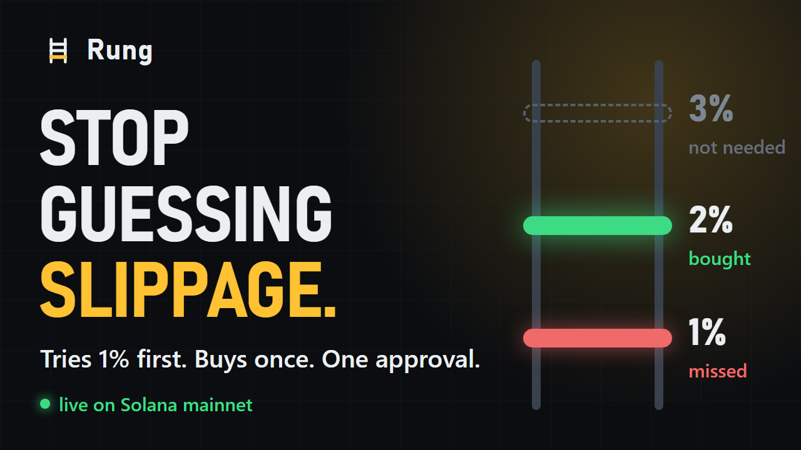
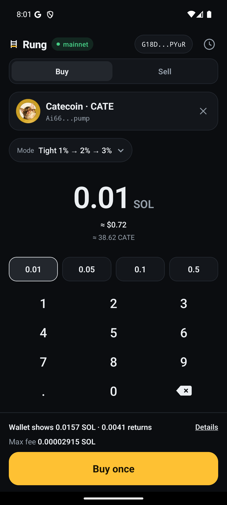
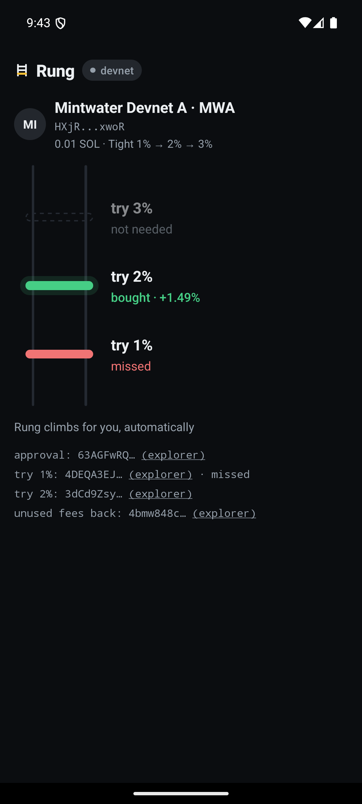
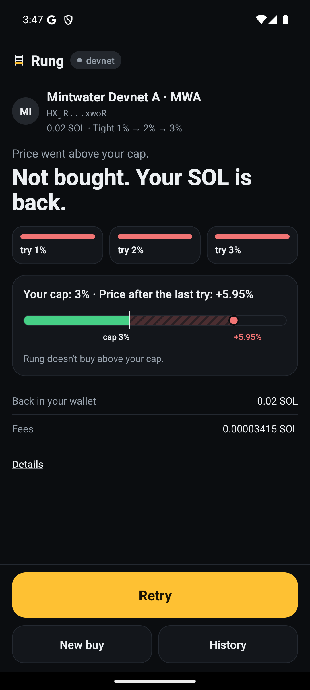
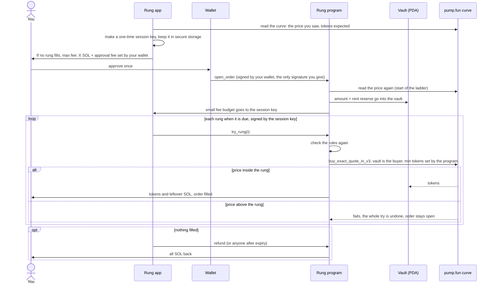

<p align="center"></p>

# Rung — stop guessing slippage. Stop feeding sandwich bots.

On Solana, set slippage too wide and a sandwich bot takes the gap; set it too tight and your buy fails. Rung finds the lowest slippage that fills: it tries 1% first, climbs only to your cap, and buys once. One approval.

- 2 out of 3 manual buys set more than 5× the slippage they needed (median typed 20%, needed 1.1%).
- 1 in 4 manual buys had no slippage protection at all.
- On established tokens, 97% of buys fill on the first 1% try.

*Our measurement: 3 windows, 232,770 buys, Nov 2026 ([samples and method](docs/NUMBERS.md)).*

**What it is.** An open on-chain order program, live on Solana mainnet, and an Android app built on it. Your wallet signs one order; the SOL waits in a vault that only the program can move; a one-time key sends the tries; the program allows one buy and sends the SOL back if nothing fills.

**[Demo video (2:24)](https://youtu.be/H-a8bBl0X3Y)** · **[Live demo](https://rungbot.xyz/)** · **[Android app (APK)](https://github.com/PRU-Blockchain/rung/releases/tag/v0.1.0)** · **[Program on Solana mainnet](https://explorer.solana.com/address/Ej2bWTwgPULuni3RVS7Krg1cNYrm5Em5WqfMcUVJUhio)** · **[Real orders you can open](#check-it-in-two-minutes)** · **[Build it into your app](#who-it-is-for)**

Dev3pack Global Hackathon, Nov 27–29, 2026 · built by [Buğra Yavaşcan](https://github.com/mryavascann) and [Marwa İpek](https://github.com/mrvipek259-ui), PRU Blockchain · [MIT](LICENSE)

<p align="center"><a href="https://youtu.be/H-a8bBl0X3Y"></a><br><a href="https://youtu.be/H-a8bBl0X3Y">▶ Watch the video (2:24)</a></p>

<p align="center">
  
  
  
</p>

*The Android app: the buy screen on mainnet; a ladder that climbed (the 1% try missed, the 2% try bought); an order that did not buy, with the SOL back. The last two are devnet test orders with the price pushed up by us ([the ladder's transactions](docs/RUNS.md#the-screens-at-the-top-of-the-readme)). The same two outcomes on mainnet, moved by other people's trades, are [below](#it-runs-on-mainnet).*

## Check it in two minutes

1. **Open [rungbot.xyz](https://rungbot.xyz/).** The phone on the page replays three real mainnet orders step by step, each step linked to its transaction. Under "Technical details" a counter is computed from the program's mainnet events.
2. **Watch a ladder climb on mainnet.** One [order](https://explorer.solana.com/tx/3cvQRfmNxPJ1vh8ckz8jPBzYDq6xFtwboxZcn5Rr9q49XFEaNrHdLBdZgi3ar86odTUGqtVPm2M9bzt7hknH1rKp), signed once by the wallet. The 1%, 2% and 3% tries failed as the price ran; the [5% try bought](https://explorer.solana.com/tx/4W4dfEsypHZWpqMaCBq2PZDe2pVcVW3fkUxvtUsFWwurzfHvA3Tnen2pejFHvEmzDBz9oKKu2SQXwM9NEHsikJ3m), 3.83% above the price seen when the order was sent. The order allowed up to 8%.
3. **Watch an order that refuses to buy.** By the time this [order](https://explorer.solana.com/tx/4A7ztAKgT1y32ajVq3fciAdzTXE9hokaRNTPKaiw1SUXfCChFtyo9nfqLRNwc6LGDy9zN5gV2uGP7pK2HYmCWoAD) landed, the price was 8.4% above the price seen and the cap was 3%. Three tries failed, the [refund](https://explorer.solana.com/tx/4wQ8yDtGHnN79RfW1RopfpvPqqQxG3gnPrG33HzjgKBg7Lzcqt2bAmpAfH1TbSPHsj4Fwi5i8Y4TGsKnaaLeFprn) returned the SOL, and the wallet ended 0.00003325 SOL lower: the "max fee" shown before the order, to the lamport.
4. **Try the app.** Install the [APK](https://github.com/PRU-Blockchain/rung/releases/download/v0.1.0/rung-0.1.0-mainnet.apk) on an Android phone (64-bit ARM) that has Solflare or Phantom, paste a pump.fun token address, pick a mode, approve once. The APK is signed with Rung's release key. It is the mainnet build and uses real SOL; an order can be as small as 0.001 SOL.
5. **No phone at hand?** [Run the ladder from the command line](#run-it-yourself) with `--dry-run`: it prints the plan and sends nothing.

## The problem

Every manual buy on a memecoin asks for one number, the slippage, and both ways of getting it wrong cost money.

*Slippage* is the most you accept paying above the price you saw; if the price moves past it, the buy fails and only the fee is spent.

A *sandwich bot* buys right before you, pushes the price up to your slippage limit, and sells right after you: it can take at most your slippage.

**Too wide.** A sandwich bot can push the price up to your limit and take the gap. Bitquery counted 6,850,144 sandwiches on Solana between Oct 30, 2025 and Oct 7, 2026, $29.7M gross, 96% of them on pump.fun curves and PumpSwap. In our replay of 661 real buys on four established pools, a single buy at 3% slippage left sandwich bots up to 21.8 SOL to take; the same buys through Rung's Tight ladder left 4.7 SOL, and every buy still filled ([the replay](#measured-on-real-trades)). Yet in our measurement, manual-like buys of $5–500 typed a median of 20.0% when they needed 1.10%, and 26.8% of manual-like buys had no protection at all. The settings screens of Axiom and Photon come set to 20% for buys (our own reading).

**Too tight.** The price moves past your limit, the buy fails and you still pay the fee: a median of $0.00041 for a failed slippage try across all buys, $0.016 for manual-like buys. Then you guess again.

**One real buy, Nov 24, 2026.** A 9 SOL buy that accepted almost any price (its limit was 400%) was pushed 131% and overpaid 4.80 SOL: [front-run](https://explorer.solana.com/tx/LJBrN4DJuzmpivdNPqDuw4k4bsFw4PdzoWJxS8nhZbrJFLTFWr9roR7WNBuUuGCdH7wapkZ7eFmhcoGyAAvKfWR), [victim](https://explorer.solana.com/tx/4xq195R48RW66BNwQUqrRPjHNGwoLLvFRCLEm7b1wdwpb7NohDmvtExJ3uVKxiU6sgLADy1JQsUbDChNBAg86M6w), [back-run](https://explorer.solana.com/tx/2u2UJLBpWQsfkqbnAYK2Ys6CiU1VgtT4oBhrKut2VJzpQaZfVzNTdUJy3TJ5hmbSNLgBuWKMh7j1pC19SMMEtgbB). Replayed with Rung Tight, that order does not buy and the SOL comes back.

You have to pick that number before the buy. Rung does not ask for it: it starts at the tightest rung and climbs only as far as you allow.

## What Rung does

1. *No guessing.* Even if you don't know what to type, you buy at the right slippage: Rung starts tightest and climbs only as needed.
2. *Sandwich protection.* An attacker can take at most your cap, and on Rung the first try starts at 1%; even for brand-new tokens, Launch mode starts at 10%, not 20–30%.
3. *You don't overpay.* If the price jumped above your cap, Rung doesn't buy; if it buys, you pay at most your cap above the price you saw.
4. *One approval, one buy.* Every try is covered by one wallet approval; the program allows at most one buy; if nothing fills, your SOL comes back.

| mode | rungs | for | fills (3 windows) |
|---|---|---|---|
| Tight | 1% → 2% → 3% | established tokens | 98.7–99.4% |
| Normal | 2% → 3% → 5% | established tokens, everyday buys | 99.3–99.7% |
| Fast | 5% → 10% → 15% | most-traded, fast-moving pools | 99.2–100% |
| Launch | 10% → 20% → 30% | a token's first two minutes | 93.6–95.2% |
| Custom | you choose 1–5 rungs and the cap | | |

At launch, Tight fills 80–81% of buys; the rest are buys where the price ran above 3%. Rung shows them as *not bought, your SOL is back*. If you must get in at launch, pick Launch.

The app sells the same way: one approval, the tightest try first.

## It runs on mainnet

The program has been on Solana mainnet since Nov 24, 2026, at [`Ej2bWTwgPULuni3RVS7Krg1cNYrm5Em5WqfMcUVJUhio`](https://explorer.solana.com/address/Ej2bWTwgPULuni3RVS7Krg1cNYrm5Em5WqfMcUVJUhio) (the same address and the same build on devnet). It buys on pump.fun bonding curves and on a token's own PumpSwap pool.

Counted Nov 27, 2026 (the [page's counter](https://rungbot.xyz/) is live): **23 orders, 20 bought, 3 not bought, no double buy.** Thirteen buys went through the command-line script and seven through the app, five of those on a real phone. Every order is the team's own test buy.

| what | outcome | paid vs. price seen |
|---|---|---|
| First buy, a PumpSwap pool, Tight | [1% try filled](https://explorer.solana.com/tx/2ZNEtvVpsiTVdcpgxoiBXBnTeknSoo1VhMwCmjhw4vHd4w7cCfP75BuQw74yf2buTXfhBKcXY7qQwYJyWj4kNt5U); Rung's fees 0.0000163 SOL | +0.00% |
| A pump.fun bonding curve, Tight | [1% try filled](https://explorer.solana.com/tx/GY6Y2LdzeJj1Zch3XFuTuXvvPVKroEGFAR2ZFqjEcsaCpCRuqHs8JAMuE1Fr2Tigrk1PQht6DH6L4KVgRRWwzQM) | +0.91% |
| A curve in its launch rush, five rungs up to 8% | 1%, 2%, 3% failed, [5% try filled](https://explorer.solana.com/tx/4W4dfEsypHZWpqMaCBq2PZDe2pVcVW3fkUxvtUsFWwurzfHvA3Tnen2pejFHvEmzDBz9oKKu2SQXwM9NEHsikJ3m) | +3.83% |
| A curve in its launch rush, Launch | [10% try filled](https://explorer.solana.com/tx/4QwNntuxY34rrZsd2obKp4NJrg1P7pnV3Wau825N3VtHpM1Pe3MdTW5astdrhqgNbbboyF5xwX7JZHZBQmmXzhxo); the order allowed up to 30% | +1.42% |
| A curve in its launch rush, Tight | price 8.4% above the price seen, cap 3%: three tries failed, [SOL refunded](https://explorer.solana.com/tx/4wQ8yDtGHnN79RfW1RopfpvPqqQxG3gnPrG33HzjgKBg7Lzcqt2bAmpAfH1TbSPHsj4Fwi5i8Y4TGsKnaaLeFprn) | not bought; cost 0.00003325 SOL |
| From the Android app, Phantom, Tight | [one approval](https://explorer.solana.com/tx/3qYNS2XSrWBWy8bv6GP8Lo34a98p2dQaRCHPqefiCovftyHifJ931Ay8dXi7x9UST1iLXTZUtfcVySvvvtYNcnrz), [1% try filled](https://explorer.solana.com/tx/3HAtsqWmr2gXKd6ywpYiWmJEiM7vej3gS7hwkALfCN955VB8AeXk7CtResvk6zyrDbvRdy5oY3CZ8xfSRkUsD6b3) two slots later | +0.01% |

Each failed try cost 6,000 lamports. On mainnet nobody on our side moved the price (the script refuses its price-moving test aid there); these are the trades of other people. <a id="mainnet-runs"></a><a id="devnet-runs"></a>Every run with all its transactions, on mainnet and on devnet: [docs/RUNS.md](docs/RUNS.md).

## Measured on real trades

On Nov 24, 2026 we replayed 6,454 real mainnet buys. For each one: with the same SOL at the same moment, what would a single buy with a fixed slippage have done, and what would a Rung ladder have done?

*Fill* is the share of buys that would have bought. *Room* is the most a sandwich bot could take in the block where the buy fills, added up over all buys: a ceiling, not money that was taken.

| | fill | room |
|---|---|---|
| **Hyped launch** (first 60 seconds of 11 launches, 4,262 buys) | | |
| one buy at 20% | 92.9% | 323 SOL |
| Rung Launch 10 → 20 → 30% | 88.4% | 140 SOL |
| **Volatile, not the launch** (12 curves, 1,531 buys) | | |
| one buy at 20% | 94.3% | 125 SOL |
| Rung Launch 10 → 20 → 30% | 93.0% | 43.5 SOL |
| **Calm** (4 established pools, 661 buys) | | |
| one buy at 3% | 100% | 21.8 SOL |
| Rung Tight 1 → 2 → 3% | 100% | 4.7 SOL |

What buyers typed in the same windows: at launches a median of 13.3%, and 59% of buys had no limit at all; in the volatile windows 73% typed 20% or more.

- On a typical buy the price doesn't change; Rung makes the difference during attacks and spikes.
- Sandwich numbers are Bitquery's; our measurement shows the gap between the slippage typed and the slippage needed.
- Measured on three 13-minute windows from the week of Nov 19–22, 2026, 232,770 buys; 'manual buy' is a behaviour rule (at most three transactions in the window, one per block, no custom program).

Every figure with its sample size and caveat, our own measurement kept apart from other people's: [docs/NUMBERS.md](docs/NUMBERS.md). The scripts are in [`measure/`](measure/README.md), the replay report in [`measure/replay/results/replay-2026-11-24.md`](measure/replay/results/replay-2026-11-24.md).

## Who it is for

**People who buy memecoins by hand.** They paste a token address, pick a mode and approve once. They do not have to type a slippage number.

**Other apps.** The Android app is the showcase; the product is the on-chain program behind it. Wallets, Telegram bots and trading terminals can give their users the same ladder without writing an on-chain program of their own. The program is live on mainnet, the code is open, and the TypeScript client in the repository builds every instruction. Want it in your product? Write to us on X: [@yavascan](https://x.com/yavascan)

**Business model.** Rung earns a small share of every filled buy: buys made in our own app, and buys made in any Telegram bot, wallet or terminal that plugs Rung in. No fill, no fee. For comparison: pump.fun takes 0.45% per trade in its own app. During the hackathon the share is zero.

Planned, in this order:

- **A fee field in the program.** A small share of a buy that fills, nothing from a buy that does not.
- **A kit for other interfaces.** Small wallets, Telegram bots and trading terminals can offer the ladder without writing and auditing a program of their own. The TypeScript client in [`client/`](client/) already builds every instruction; planned are a published package and a short guide.
- **The Solana dApp Store.** Rung is a native Android app; listing it there is the first place to meet buyers on mobile.
- **A bolder ladder** for buyers who want to be sure to buy. Today the program caps a ladder at 30%. In the [replay](measure/replay/results/replay-2026-11-24.md), 15 → 25 → 35 → 50% filled as often as one buy at 25% (launches: 95.0% against 94.8%) with about half the room in the block where it fills (191 against 390 SOL). It needs a program change.

## Why we built this

> When I was buying memecoins I got sandwiched a lot. Chasing coins at launch, I had no idea how to set slippage; so that I would not miss the token I typed something like 50%, and many times I bought far too high.
>
> I did not realise it at the time. But when the chance to build something on Solana came up, the first thing I thought was: could I solve this? So that is what I went for.
>
> We know this is a problem that can really be solved. And we want to solve it.
>
> — Buğra Yavaşcan

## How it works



1. **Quote.** The app reads the pump.fun bonding curve and shows the price you saw and how many tokens your amount buys now.
2. **One approval.** The app makes a one-time session key for this buy and keeps it in the phone's secure storage (`expo-secure-store`). Your wallet then signs one transaction, `open_order`. It writes the order on chain (rungs, cap, amount, the tokens you expect at the price you saw, timing, the session key), moves the amount and a small rent reserve into a vault the program controls (a program-derived address per user; one open order per user), and sends the session key a small fee budget for the tries.
3. **The rungs.** The session key sends one `try_rung` per rung as it becomes due (4 slots apart in the devnet runs). The program buys through pump.fun's `buy_exact_quote_in_v3` with the vault as the buyer. If the price is above the rung, pump fails the transaction, nothing moves, the order stays open and only that try's fee is spent.
4. **Filled or refunded.** On a fill the tokens go to your token account and the SOL that was not spent goes back to your wallet, in the same transaction; the order is marked filled and every later try is rejected (`OrderFilled`). If no rung fills, the session key calls `refund` (anyone may call it once the order has expired) and the vault's SOL and the order account's rent go back to you. You can also `cancel` with your own wallet, which is a second approval. Afterwards the app sends what is left of the fee budget back to your wallet and deletes the session key.

### How does one approval cover every try?

Your wallet signs only the transaction that writes the order and its rules on chain. The tries are sent by the one-time session key tied to that order, and the program checks the rules again on every try:

- the signer is the session key written in the order;
- the order is still open and has not bought yet (at most one buy per order);
- the rung exists in the order, so it is not above the cap;
- the rung is due (`start slot + rung × window`) and the order has not expired;
- the fewest tokens the buy may return is computed by the program from the order, not by the key.

The session key cannot loosen any of these, cannot send SOL anywhere but to you, and holds only the fee budget.

**Two references.** The fewest tokens a rung may buy is the stricter of two limits: (1) the cap measured from the price you saw when you tapped Buy, so no buy is ever more than your cap above that price; (2) the rung measured from the price the program read from the curve when the order landed on chain, which is where the ladder starts.

**The program measures the buy itself.** After pump returns, the program checks the increase in the vault's token account against the rung's minimum, and checks that the SOL that left the vault is at most the order amount plus a small rent allowance (0.0025 SOL). It does not take pump's word for either.

**Fees.** Before you approve, the app shows **"If no rung fills, max fee: X SOL"**. On a bonding curve each try costs 6,000 lamports whether it buys or not, so three rungs cost at most 18,000 lamports (0.000018 SOL). The formula, and what each wallet adds to the approval, are in [docs/TECHNICAL.md](docs/TECHNICAL.md#fees).

## Why Solana

The problem, the users and the money are here. This is where the hyped tokens launch: 96% of the sandwiches Bitquery counted on Solana were on pump.fun curves and PumpSwap. Both properties that make the ladder practical are here too: the result of a try is known in under a second, and a try that misses is cheap (its base is $0.0004).

Supporting number: over three years, sandwiches in the "protected" flow numbered 28.0M on Solana, 30,607 on Ethereum and 1,889 on Base (arXiv 2609.28115, a preprint that uses Bitquery's method).

What the code uses on Solana:

- **An Anchor program** with four instructions (`open_order`, `try_rung`, `refund`, `cancel`), one vault per user at a program-derived address, and events (`OrderOpened`, `OrderFilled`, `OrderRefunded`) the web counter is computed from.
- **Calls into pump.fun and PumpSwap** from the program (`buy_exact_quote_in_v3`, `buy_exact_quote_in_v2`), with the vault as the buyer, for Token-2022 and SPL Token mints. Both program addresses are fixed in the program; any other buy program is rejected.
- **Mobile Wallet Adapter** in the Android app, with the app's identity verified by the wallets through [`assetlinks.json`](https://rungbot.xyz/.well-known/assetlinks.json). Buys filled with Phantom, Solflare and Solana Mobile's mock wallet.
- **A one-time session key** per order that can only try that order's rungs or refund it.
- **Pyth's SOL/USD price account**, read by the app for the dollar value on the buy screen.
- **Jito bundles** in the command-line script (`--jito`): each try goes to Jito's block engine as a bundle of one transaction. Two mainnet buys so far.

## What is built

| part | state |
|---|---|
| On-chain order program (`programs/rung/`) | on mainnet and devnet, same build, verified byte for byte after the deploy. Buys on pump.fun bonding curves and on PumpSwap pools |
| Android app (`app/`) | works on mainnet on an Android 16 phone with Solflare, and on an Android 15 emulator: paste a token (also from a copied link), pick a mode, one wallet approval, live ladder, receipt, not-bought screen with a retry in the mode you pick, selling with the same ladder, history that opens offline |
| APK | [release v0.1.0](https://github.com/PRU-Blockchain/rung/releases/tag/v0.1.0): the mainnet build, signed with Rung's release key |
| Demo video | [on YouTube](https://youtu.be/H-a8bBl0X3Y), 2 minutes 24 seconds |
| Web page (`web/`) | live at https://rungbot.xyz/; the phone on the first screen replays three mainnet orders of Nov 24, 2026 (recorded, not live); the counter is computed from the program's mainnet events |
| TypeScript client (`client/`) and command-line script (`scripts/ladder.ts`) | build every instruction and run the ladder on devnet, on a local fork of mainnet and on mainnet |
| Tests | 226 Rust tests of the program and 240 client tests; further tests run the program against the real pump.fun and PumpSwap programs dumped from mainnet and on a local fork of mainnet |
| Measurement scripts (`measure/`) | in the repository, with the tables they produced |

## Security and limits

**unaudited, use small amounts.** The program was reviewed twice by independent read-only passes; those are reviews, not an audit. Neither reported a critical or high finding.

| what happens | what follows |
|---|---|
| The phone turns off, the app crashes, the session key is lost | Once the order expires, `refund` returns the SOL to you. Anyone may call it; the app calls it when it opens again. SOL and the order's rent can only go to your wallet |
| The session key is stolen | The thief can only call `try_rung` for this order, only when a rung is due and only up to your cap. Tokens still go to you; the key cannot withdraw from the vault and cannot loosen the rules. It can, however, trigger the buy at a bad price up to your cap. It can spend at most the fee budget on the key (0.002 SOL per order at most) |
| A bug in the program | The SOL in the vault is at risk. Limits: at most 0.5 SOL per order, one open order per user, tests, a small program |
| Upgrade authority | Held by the team (the wallet that deployed the program) |

- At most 0.5 SOL per order; at least 0.001 SOL. The highest cap any order can set is 30%.
- Adverse selection: Rung does not buy when the price runs away, and the buys it misses are often the tokens that rise most.
- Tried on an Android 16 phone and on the Android emulator.
- Buys on pump.fun bonding curves and on a token's own (canonical) PumpSwap pool paired with SOL. Other pools and cashback pools: no.

The full table and what the two reviews changed: [docs/TECHNICAL.md](docs/TECHNICAL.md#security-and-limits).

## Before the event and during it

The event runs Nov 27–29, 2026. The line is commit [`b48b0fb`](https://github.com/PRU-Blockchain/rung/commit/b48b0fb) (Nov 27, 00:45 UTC+3), the last one before our first working session of Nov 27: everything up to it was done before the event, the commits after it during the event days.

**Before** (the measurement on Nov 22; the repository from Nov 23 up to that commit): the measurement of 232,770 buys; the order program and its tests; the deploy to mainnet on Nov 24 and the first mainnet runs; the replay of 6,454 real buys; the Android app on the emulator, with its first mainnet buys; the web page with the counter; the domain and the wallets' verification of the app.

**During (from Nov 27):**

- selling with the same ladder, and Buy | Sell tabs in the app;
- a new not-bought screen, with a retry in the mode you pick;
- the token address pasted with one tap, also from a copied link; the buy screen opens with the last amount and mode;
- custom rungs typed in boxes with the app's own keypad;
- a smaller deposit: the rent of accounts that already exist is no longer sent with the order, and the buy screen shows the number the wallet will show;
- wallet fixes: instant disconnect, a clear message for a wrong account, a balance check after connecting;
- the signed release and the published APK (v0.1.0), and the first buys, a not-bought order with its retry, and a sale on a real phone;
- on the web page: the demo phone follows the app's screens, "Technical details", "Build Rung into your app".

## Run it yourself

<a id="tests"></a><a id="setup"></a>

```bash
anchor test                                  # 226 Rust tests of the program (LiteSVM)
cd client && npm install && npm test         # 240 client tests
```

The ladder from the command line, on devnet unless told otherwise:

```bash
client/node_modules/.bin/tsx scripts/ladder.ts --find-mint
client/node_modules/.bin/tsx scripts/ladder.ts --mint <MINT> --amount 0.01 --mode tight --dry-run
```

Drop `--dry-run` to send real devnet transactions from a devnet keypair you fund yourself. The script refuses mainnet unless it is told `--mainnet`, and then its rules are tighter: [docs/RUNS.md](docs/RUNS.md#command-line-devnet-unless-told-otherwise).

| path | what |
|---|---|
| `programs/rung/` | the order program and its tests |
| `client/` | TypeScript client: addresses, instruction builders, quote, fee budget, the sender that tries the rungs |
| `app/` | Android app (React Native + Expo); building it from source: [`app/README.md`](app/README.md) |
| `web/` | the web page (Next.js, on Vercel) |
| `measure/` | the scripts behind the measured numbers and their results |
| `docs/` | [runs](docs/RUNS.md), [numbers](docs/NUMBERS.md), [technical reference](docs/TECHNICAL.md) (fees, wallets, addresses, toolchain versions, tests against the real programs and a mainnet fork) |

## Sources

- Bitquery, Solana sandwich attacks: https://bitquery.io/investigations/solana-sandwich-attacks
- CryptoSlate on Bitquery's estimate: https://cryptoslate.com/solana-sandwich-bots-took-29-7-million-before-costs-bitquery-estimates/
- TokenPost: https://www.tokenpost.com/news/technology/24728
- Jupiter, slippage: https://developers.jup.ag/docs/swap/advanced/slippage
- OKX DEX FAQs: https://web3.okx.com/help/okx-dex-faqs
- pump.fun public docs and IDL: https://github.com/pump-fun/pump-public-docs
- pump.fun fees: https://pump.fun/docs/fees

## License

MIT. See [LICENSE](LICENSE).
